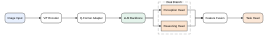

# PaperCanvas

**Agent-native scientific figure engine.** Create, edit, and export
publication-ready **SVG, PDF & PPTX** with MCP, CLI, and structured patches —
the figure stays editable vector, never a bitmap.

[](https://github.com/HarryHeYu/figcraft/actions/workflows/ci.yml)


A versioned **Figure IR** (JSON) is the single source of truth. Coding agents
modify it through semantic patches — change one node without re-drawing the
figure — and deterministic renderers produce true-vector output for papers,
theses, and slides.

## What it looks like

Real rendered output from the bundled examples (committed SVGs, shown inline):

<p>
  
  
  
</p>

| Example | Figure | Sources |
|---|---|---|
| [basic_pipeline](examples/basic_pipeline.json) | Linear ML pipeline | [SVG](examples/basic_pipeline.svg) · [PDF](examples/basic_pipeline.pdf) · [PPTX](examples/basic_pipeline.pptx) |
| [video_unlearning](examples/video_unlearning.json) | Video unlearning framework | [SVG](examples/video_unlearning.svg) · [PDF](examples/video_unlearning.pdf) · [PPTX](examples/video_unlearning.pptx) |
| [multi_branch](examples/multi_branch.json) | Multi-branch architecture with grouped heads | [SVG](examples/multi_branch.svg) · [PDF](examples/multi_branch.pdf) · [PPTX](examples/multi_branch.pptx) |

## Why PaperCanvas

- **Agent-native**: seven MCP tools plus a CLI on one shared service layer —
  agents patch figures incrementally; untouched objects never move.
- **Figure IR as the single source of truth**: SVG/PDF/PPTX are build
  products; nothing is hand-edited, everything is reproducible.
- **Transactional semantic patches**: nine operations applied all-or-nothing
  with revision control — a failed patch leaves the file byte-identical.
- **Truly vector, truly editable**: SVG `<text>`, PDF with embedded TTF
  subsets, PPTX with native shapes/connectors — no rasterization anywhere.
- **Deterministic**: same IR + same fonts ⇒ byte-identical output; safe to
  re-export and diff.
- **Quality lint built in**: FC001–FC008 (overflow, overlap, arrows through
  nodes, font substitution, …) with machine-readable JSON output.

## 60-second quickstart

```bash
pip install papercanvas        # PyPI publication pending final approval
# for now, from a clone:
uv sync

papercanvas init figures.json --id demo

# 2. describe the figure as a patch (save as ops.json)
cat > ops.json <<'JSON'
{
  "operations": [
    {"op": "add_node", "node": {"id": "input",  "type": "rounded_rect", "label": "Input Video"}},
    {"op": "add_node", "node": {"id": "encoder", "type": "rounded_rect", "label": "Video Encoder"}},
    {"op": "add_node", "node": {"id": "output",  "type": "rounded_rect", "label": "Prediction"}},
    {"op": "add_edge", "edge": {"id": "e1", "source": "input",  "target": "encoder"}},
    {"op": "add_edge", "edge": {"id": "e2", "source": "encoder", "target": "output"}}
  ]
}
JSON

papercanvas patch figures.json --ops ops.json
papercanvas layout figures.json --preset layered
papercanvas lint figures.json
papercanvas render figures.json --format all
# -> figures.svg figures.pdf figures.pptx

# 3. revise in place — rename ONE node and re-render, no rebuild:
echo '{"operations": [{"op": "update_label", "target": "output", "label": "Final Prediction"}]}' > round2.json
papercanvas patch figures.json --ops round2.json
papercanvas render figures.json --format all
````

Windows PowerShell: replace the `cat > ops.json <<'JSON' ... JSON` block with
`@' ... '@ | Set-Content ops.json` (same JSON), and the last patch with
`echo '...' | ...` via a file — process substitution `<(...)` is bash-only.

Try it without writing anything:

```bash
uv run papercanvas build examples/basic_pipeline.json --format all
uv run papercanvas lint examples/basic_pipeline.json
```

## CLI

```
papercanvas init PATH --id FIGURE_ID [--width] [--height] [--margin]
papercanvas validate PATH
papercanvas patch PATH --ops ops.json        # {"operations": [...], "expected_revision": N}
papercanvas layout PATH --preset linear-h|linear-v|layered
papercanvas lint PATH [--min-font-size PT] [--format text|json]
papercanvas inspect PATH [OBJECT_ID] [--format text|json]
papercanvas render PATH [--format svg|pdf|pptx|all] [--out FILE]
papercanvas build PATH [--preset ...] [--format ...]   # layout + render in one command
```

Every mutating command is transactional: validation errors leave the file
byte-identical; successes bump `revision` by one.

## MCP server (for coding agents)

```bash
papercanvas-mcp --root path/to/project
```

Seven tools: `papercanvas_create`, `papercanvas_get`, `papercanvas_patch`,
`papercanvas_layout`, `papercanvas_render`, `papercanvas_lint`,
`papercanvas_inspect`. All paths must stay inside `--root`; failures return
structured `{"ok": false, "error": ...}` so agents can self-correct. See
[docs/mcp.md](docs/mcp.md).

### Codex / Claude Code / OpenCode

PaperCanvas speaks standard MCP stdio, so any MCP client works. Point the
client at `papercanvas-mcp` with the project directory as `--root`:

- **Claude Code**: `claude mcp add papercanvas -- papercanvas-mcp --root .`
  (or add the JSON below to `.mcp.json` in the project)
- **Codex CLI**: add to `~/.codex/config.toml`:
  `[mcp_servers.papercanvas]` with `command = "papercanvas-mcp"`,
  `args = ["--root", "."]`
- **OpenCode**: add to `opencode.json`:
  `"mcp": {"papercanvas": {"type": "local", "command": ["papercanvas-mcp", "--root", "."]}}`

Generic stdio JSON (most clients accept this shape):

```jsonc
{
  "mcpServers": {
    "papercanvas": {
      "command": "papercanvas-mcp",
      "args": ["--root", "."]
    }
  }
}
```

The Agent Skill at
[`skills/papercanvas/SKILL.md`](skills/papercanvas/SKILL.md) (bundled inside
the wheel at `papercanvas/skills/SKILL.md`) teaches agents the full
workflow. Verification scope: all tool behavior is covered by real-protocol
tests ([tests/test_mcp_e2e.py](tests/test_mcp_e2e.py),
[tests/test_mcp_stdio.py](tests/test_mcp_stdio.py)); the third-party client
UIs themselves were not exercised in this project's environment.

## Install as a DSH plugin

PaperCanvas is also a **DeepSeek Harness plugin** — the seven tools surface
directly inside DSH sessions:

```bash
dsh plugin --profile <profile> add github:HarryHeYu/figcraft
```

The plugin is a thin adapter over the `papercanvas` CLI (which must be
installed — from this repository until the PyPI publication). Verified
channels, same discipline as [dsh-sessionflow](https://github.com/HarryHeYu/dsh-sessionflow):

| DSH | install resolves | DSH loads it | tool call answered |
|---|---|---|---|
| `0.1.5-rc.3` | ✅ | ✅ | ✅ |
| `0.2.0-rc.2` (`next`) | ✅ | ✅ | ✅ |
| `0.2.1-rc.5` (`next`) | ✅ | ✅ | ✅ |
| `0.2.2-alpha.2` (`alpha`) | ✅ | ✅ | ✅ |

Cold-start CI: [cold-start-figcraft](https://github.com/HarryHeYu/figcraft/actions/workflows/cold-start-figcraft.yml) —
5 matrix rows (install path × DSH channel), each proving install → bundle →
prepare → profile layer → a real bridge call into the engine.

## The Figure IR in one minute

Copy-paste this into `quickstart.json` — it validates and renders as-is:

```json
{
  "schema_version": "0.1",
  "id": "method_pipeline",
  "revision": 1,
  "canvas": {"width": 100, "height": 40, "unit": "mm", "margin": 4},
  "theme": {"font_family": "Arial", "font_size_pt": 8, "palette": {}},
  "nodes": [
    {
      "id": "input",
      "type": "rounded_rect",
      "label": "Input Video",
      "x": 8, "y": 13, "w": 34, "h": 14,
      "style": {"fill": "#E8F0FE", "stroke": "#4275C4"}
    },
    {
      "id": "encoder",
      "type": "rounded_rect",
      "label": "Video Encoder",
      "x": 58, "y": 13, "w": 34, "h": 14,
      "style": {"fill": "#E5F4EC", "stroke": "#418968"}
    }
  ],
  "edges": [
    {
      "id": "e1",
      "source": "input",
      "target": "encoder",
      "source_port": "right",
      "target_port": "left",
      "style": {"stroke": "#444444", "arrow": "end"}
    }
  ],
  "groups": []
}
```

```bash
uv run papercanvas validate quickstart.json   # -> valid
uv run papercanvas render quickstart.json     # -> quickstart.svg
```

## Capabilities & limitations

Figure IR v0.1 supports boxes (`rect` / `rounded_rect`), port-annotated
edges with orthogonal routing, groups, palette-driven styling, auto-sizing,
layered/linear layouts, and FC001–FC008 lint. CJK labels are measured and
rendered with a system CJK font when one exists (FC007 reports the
substitution). The full IR reference is in
[docs/figure-ir.md](docs/figure-ir.md).

## Naming (final decision)

| Surface | Name |
|---|---|
| GitHub repository | `HarryHeYu/figcraft` ("FigCraft" is the historical codename) |
| PyPI package | `pip install papercanvas` (verified available) |
| CLI | `papercanvas` |
| MCP server & tool prefix | `papercanvas-mcp`, `papercanvas_*` |
| Python import | `papercanvas` |

## Documentation

- [Figure IR reference](docs/figure-ir.md)
- [MCP server](docs/mcp.md)
- [Architecture](docs/architecture.md)
- [Versioning & compatibility](docs/versioning.md)
- [Release checklist](docs/release-checklist.md)
- [Changelog](CHANGELOG.md) · milestone history in
  [PROJECT-PLAN.md](PROJECT-PLAN.md)

## Contributing

Issues and PRs welcome — see
[CONTRIBUTING.md](CONTRIBUTING.md). Security reports: [SECURITY.md](SECURITY.md).

## Roadmap

- v0.2: obstacle-aware routing everywhere, broader CJK font fallback,
  two-column paper presets, visual regression baselines
- later: additional figure types, web canvas exploration

## License

[MIT](LICENSE)
